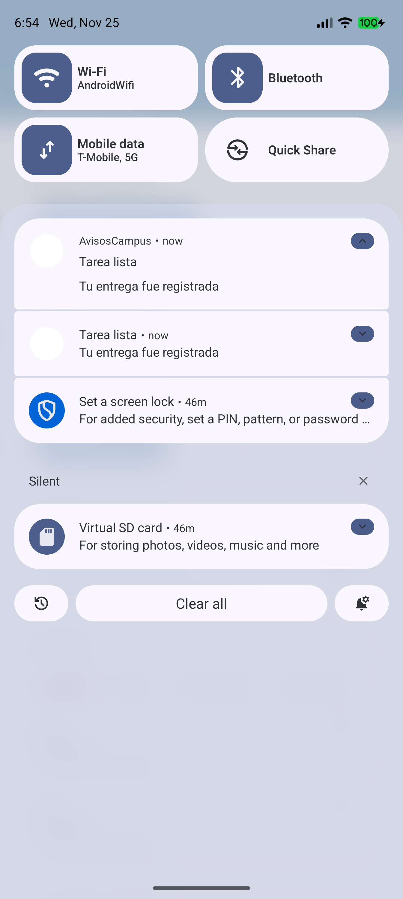
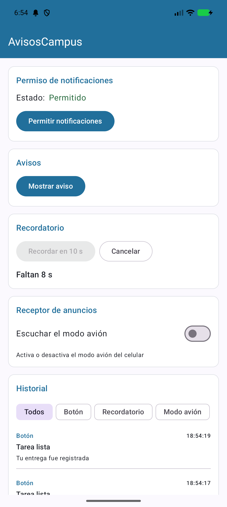
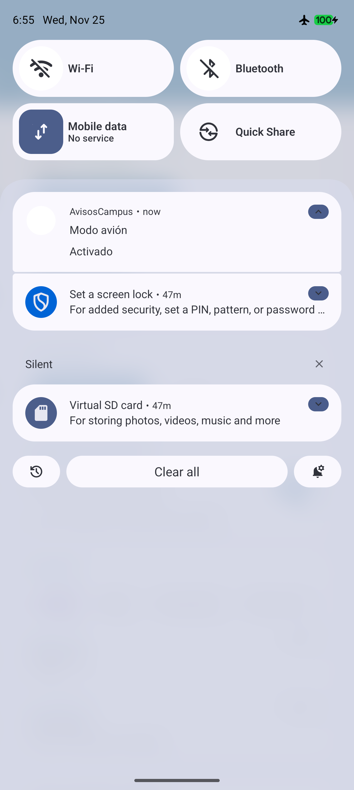
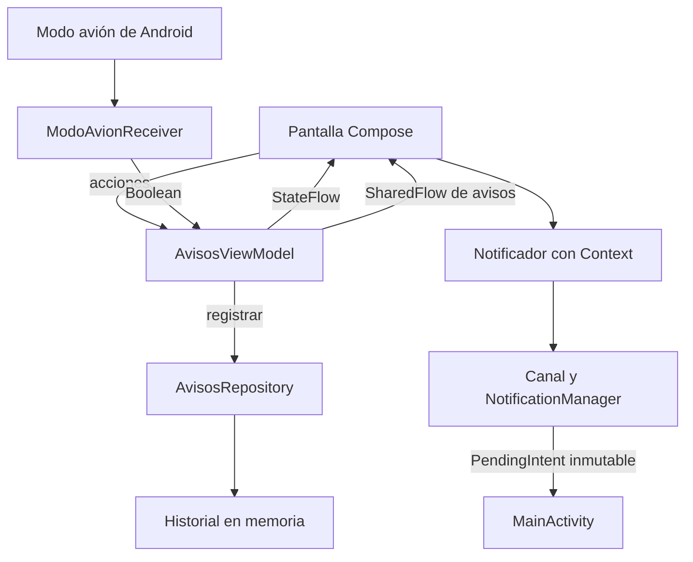

# AvisosCampus

Daniella Leon · Laboratorio 15 · Fase 1

App Android que muestra notificaciones locales, programa un recordatorio de diez segundos, escucha el modo avión y conserva un historial en memoria. Paquete `com.leon.avisoscampus`. Funciona sin internet, Firebase ni claves.

Repositorio público: https://github.com/Daniellaln/AvisosCampusLeon

## Dos fases

`main` contiene esta fase 1 funcional con el orden y las tarjetas azules de la guía. El rediseño y las mejoras de fase 2 irán después en `mejora-ia`; no se han implementado todavía. Se reconstruyó la base a partir de los contratos, modelos y ejemplos del Word porque no se recibió un proyecto descargable. Hubo asistencia de Codex: no se afirma que la fase haya sido realizada sin IA. Los mensajes naturales de commits siguen la preferencia expresa de Daniella, manteniendo un avance por paso.

## Abrir y probar

Abre esta carpeta en Android Studio, con JDK 21 y SDK 37. Gradle descarga las dependencias la primera vez; la app no necesita red. `minSdk 24`, `targetSdk 36`. Prueba en Android 13 o superior para ver el diálogo de POST_NOTIFICATIONS.

1. Pulsa Permitir notificaciones y acepta o deniega en el diálogo de Android.
2. Pulsa Mostrar aviso dos veces. Son dos avisos distintos; toca uno desde la bandeja para abrir la app y quitarlo.
3. Pulsa Recordar en 10 s. La cuenta continúa al minimizar o rotar mientras el proceso vive. Cancelar detiene el trabajo y no genera aviso.
4. Activa Escuchar el modo avión. Cambia el ajuste del celular para recibir Activado o Desactivado; al apagar el switch no se generan esos avisos.
5. Desplázate al historial. El filtro propio muestra Todos, Botón, Recordatorio o Modo avión sin borrar los otros registros.

## Función propia desde fase 1

**Filtro del historial por origen.** No está pedido en la guía. Permite encontrar avisos del botón, recordatorios o cambios del modo avión; filtra antes de tomar los veinte más recientes y conserva la lista completa. Se mantendrá en la fase 2.

## Capturas reales

Tomadas en emulador Pixel 8 Pro API 37 en Windows. Los cuadros de permiso, Ajustes y la bandeja son pantallas reales de Android. No son maquetas.

| Notificación en la bandeja | Recordatorio |
|---|---|
|  |  |

| Modo avión | Historial |
|---|---|
|  |  |

| Permiso denegado | Función propia |
|---|---|
|  |  |

[Galería completa](docs/GALERIA.md) · [Aceptación y pruebas](docs/VERIFICACION.md) · [Rutas para exponer](docs/GUIA_CODIGO.md) · [Código de cada commit](docs/GUIA_COMMITS_MAIN.md)

## Estructura

```text
app/src/main/java/com/leon/avisoscampus/
  AvisosApp.kt                     canal e instancia del Repository
  MainActivity.kt                  composición y factory
  model/Modelos.kt                 Aviso, Origen, PermisoUi
  data/AvisosRepository.kt          contrato e implementación en memoria
  notificacion/Notificador.kt       permiso, canal, notificación y PendingIntent
  receiver/ModoAvionReceiver.kt     acción de modo avión y callback corto
  viewmodel/AvisosViewModel.kt      StateFlow, SharedFlow, Job y filtro
  viewmodel/AvisosViewModelFactory.kt
  ui/PantallaAvisos.kt              permisos, eventos y DisposableEffect
  ui/HistorialAvisos.kt             últimos veinte y filtro, sin ViewModel
  ui/theme/Theme.kt                tema azul de fase 1
```



El ViewModel decide qué avisar y registra el aviso; la pantalla recoge el evento y llama al Notificador. El ViewModel y Repository no reciben Context. El receptor solo lee acción/estado; la pantalla lo registra con RECEIVER_NOT_EXPORTED y siempre lo retira en onDispose. No hay lista desplazable dentro de otra: el historial usa Column y veinte filas.

## Para pensar

**¿Por qué canal y permiso?** Desde Android 8 el canal agrupa y configura avisos; si falta un canal válido, la notificación no se muestra. Desde Android 13 se pide permiso; denegarlo impide mostrar los avisos normales. La app conserva el registro y permite abrir Ajustes.

**¿Por qué el ViewModel emite un evento?** Decide la acción sin conocer Context ni NotificationManager. La pantalla tiene acceso a Android y realiza el efecto, por lo que la lógica se puede probar con Kotlin y un Repository controlado.

**¿El mismo id dos veces?** La segunda notificación actualiza o reemplaza a la anterior. El Repository asigna ids diferentes dentro de la sesión para mantener avisos separados.

**¿Por qué onReceive corto y quitar el receptor?** El sistema espera una respuesta breve; no es el lugar para tareas largas. Mientras está registrado, el receptor retiene el contexto. onDispose lo desregistra y evita fugas o escuchas duplicadas al recrear la pantalla.

**¿Local o push de Firebase?** Local para una acción que ya conoce el celular, como este recordatorio o su modo avión. Push para una novedad enviada por un servidor, como un aviso institucional. Firebase no se usa en esta fase.

## Comprobaciones y límites

17 pruebas JVM y 12 Android aprobadas: 29 en total. Compilación debug y lint sin errores; las advertencias y XML se conservan en docs/pruebas. El recorrido adicional comprueba la bandeja real, permiso denegado, abrir Ajustes, tocar/autoCancel, diez segundos, minimizado, cancelación, rotación, avión con switch activo/inactivo y filtros. Las pruebas finales no se atribuyen a versiones anteriores; cada avance se compiló antes de su commit.

El historial y los ids son de la sesión del proceso; no son persistentes. El recordatorio usa viewModelScope, no WorkManager, alarma ni servicio: no garantiza entrega después de forzar cierre, muerte del proceso, reinicio o suspensión prolongada. El historial representa avisos generados, incluidos los bloqueados por permiso; no es un recibo de entrega del sistema. No se afirma prueba en Mac ni teléfono físico.
