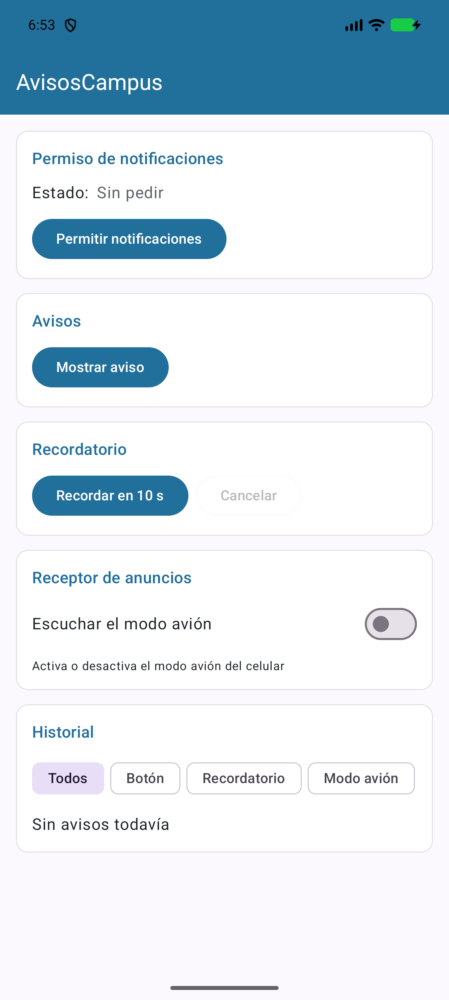
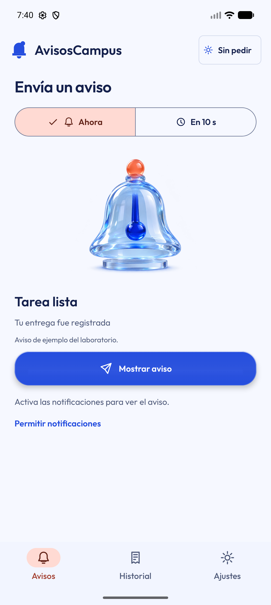
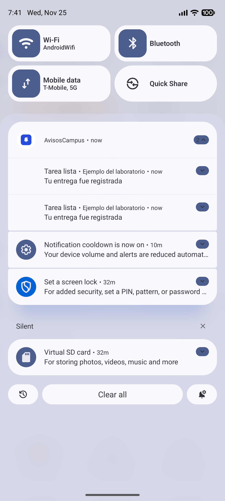
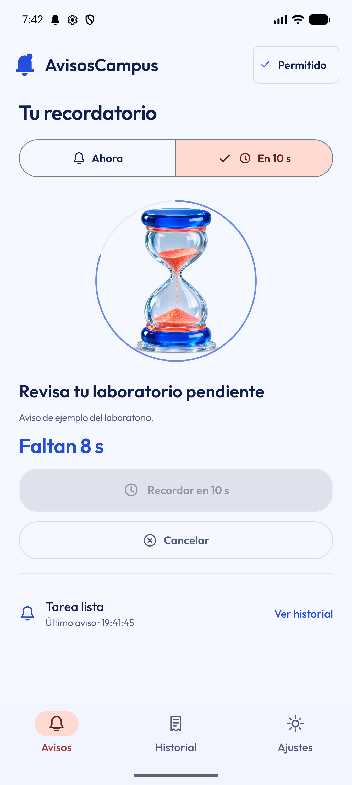
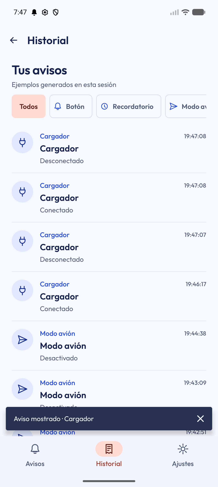
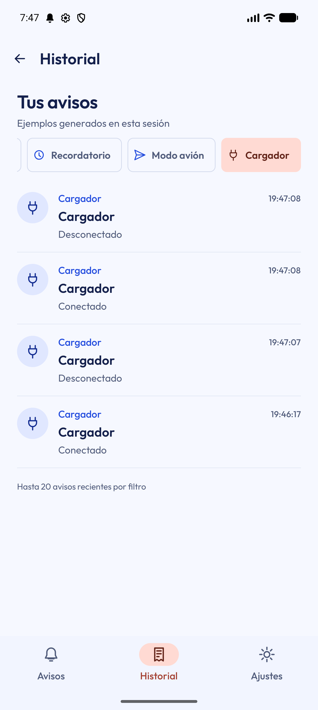
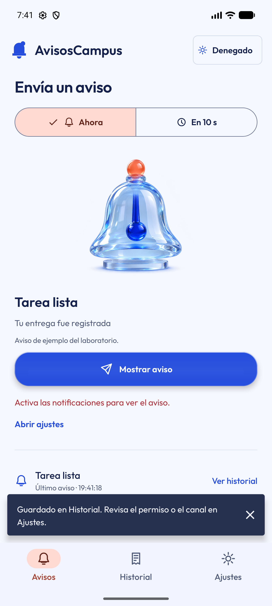

# AvisosCampus

Daniella Leon · Laboratorio 15 · Android nativo

App de práctica con notificaciones locales, recordatorio cancelable de diez segundos y escucha de modo avión y cargador. Los avisos son ejemplos del laboratorio. Funciona sin internet, Firebase, servidor, archivos JSON de datos ni claves.

[Repositorio público](https://github.com/Daniellaln/AvisosCampusLeon)

## Dos fases

| Fase | Rama | Avances |
|---|---|---|
| 1 · Base funcional con las tarjetas de la guía | [main](https://github.com/Daniellaln/AvisosCampusLeon/tree/main) | 11 commits |
| 2 · Luz y vidrio, navegación y tres mejoras aprobadas | [mejora-ia](https://github.com/Daniellaln/AvisosCampusLeon/tree/mejora-ia) | 6 adicionales; 17 en total |

La base se reconstruyó desde el Word porque no se recibió un proyecto descargable. Hubo asistencia de Codex en el desarrollo. [PROMPTS.md](PROMPTS.md) reúne seis bloques preparados para Gemini; no se afirma una ejecución de Gemini.

| Fase 1 · main | Fase 2 · mejora-ia |
|---|---|
|  |  |
| Funciones en tarjetas apiladas. | Avisos, Historial y Ajustes separados; una tarea principal visible. |

## Abrir y probar

Abre la carpeta en Android Studio con JDK 21 y SDK 37. Gradle descarga dependencias la primera vez; usar la app no requiere red. Paquete com.leon.avisoscampus, minSdk 24, targetSdk 36 y compileSdk 37.

1. En Avisos, permite notificaciones y acepta o deniega el diálogo de Android 13 o superior. Ajustes muestra Sin pedir, Permitido o Denegado; solo pide el permiso cuando está sin pedir y, después, ofrece Abrir ajustes.
2. En Ahora, pulsa Mostrar aviso dos veces. Los ids son distintos. Tocar una notificación abre la app y la retira de la bandeja.
3. Elige En 10 s y programa el recordatorio. Puedes cancelar. La cuenta continúa al cambiar de destino, rotar o minimizar mientras el proceso vive.
4. En Ajustes activa las escuchas independientes. Cambiar el modo avión o conectar y desconectar el cargador genera sus avisos; con el interruptor apagado, no.
5. En Historial filtra por Todos, Botón, Recordatorio, Modo avión o Cargador. Revisa también Avisos y Urgentes desde Ajustes.

## Función propia y mejoras

**Función propia desde fase 1: filtro del historial por origen.** No la pide la guía. Filtra antes de tomar los veinte avisos más recientes y conserva los demás registros. Fase 2 la mantiene y añade CARGADOR.

Las tres mejoras aprobadas son:

- **Canal Urgentes:** IMPORTANCE_HIGH para recordatorios; Avisos conserva importancia normal para botón, modo avión y cargador. Android y la configuración del usuario deciden cómo se presentan.
- **Texto expandido:** BigTextStyle conserva el mensaje completo, incluidos textos largos y saltos de línea, al expandir la notificación.
- **Escucha de cargador:** receptor e interruptor propios, independientes de modo avión, con origen en el historial.

El rediseño añade Outfit local, tres ilustraciones transparentes y catorce SVG con sus VectorDrawable. El botón responde al tacto, la campana al envío y el progreso a los segundos reales; las transiciones se eliminan con escala cero del sistema. Es Compose con tratamiento de vidrio, sin API de Apple ni refracción dinámica del fondo.

## Cinco capturas de fase 2

Capturas reales de Pixel 8 Pro emulado, Android API 37, en Windows. Los diálogos, Ajustes y la bandeja pertenecen a Android.

| Notificación | Recordatorio |
|---|---|
|  |  |

| Modo avión en Historial | Historial con función propia |
|---|---|
|  |  |

| Permiso denegado |
|---|
|  |

Fase 2: [galería completa](docs/GALERIA_FASE2.md) · [pruebas](docs/VERIFICACION_FASE2.md) · [código y líneas](docs/GUIA_CODIGO_FASE2.md) · [seis commits](docs/GUIA_COMMITS_FASE2.md) · [diseño](DESIGN.md) · [recursos y licencias](diseno/RECURSOS.md).

Fase 1: [galería](docs/GALERIA.md) · [29 pruebas históricas](docs/VERIFICACION.md) · [código](docs/GUIA_CODIGO.md) · [once commits](docs/GUIA_COMMITS_MAIN.md). Sus capturas y evidencias se conservan en docs/capturas y docs/pruebas.

## Estructura

```text
app/src/main/java/com/leon/avisoscampus/
  AvisosApp.kt                   canales y Repository
  MainActivity.kt                composición y factory
  model/Modelos.kt               Aviso, Origen y PermisoUi
  data/AvisosRepository.kt        historial en memoria
  notificacion/Notificador.kt     permisos, canales, BigTextStyle e intent
  receiver/                      modo avión y cargador
  viewmodel/AvisosViewModel.kt    StateFlow, SharedFlow, cuenta y filtro
  ui/PantallaAvisos.kt            tres destinos y efectos Android
  ui/HistorialAvisos.kt           filtro y veinte resultados
  ui/GlassControls.kt            botón, ilustración y movimiento
  ui/theme/Theme.kt               Outfit y esquemas claro/oscuro
```

El ViewModel decide y registra; la pantalla recoge el evento y llama al Notificador. ViewModel y Repository no guardan Context. El recolector y ambos receptores están fuera del contenido de las pestañas, así que navegar no los interrumpe. Los receptores leen el cambio, llaman a un callback breve y se retiran en onDispose.

## Para pensar

**¿Por qué canal y permiso?** Desde Android 8 el canal agrupa y configura avisos. Desde Android 13 se pide permiso para mostrarlos. Si se bloquean, la app conserva el registro y permite abrir Ajustes.

**¿Por qué el ViewModel emite un evento?** Decide sin conocer Context ni NotificationManager. La pantalla realiza el efecto Android y la lógica se puede probar con un Repository controlado.

**¿El mismo id dos veces?** La segunda notificación reemplaza o actualiza la anterior. El Repository asigna ids distintos dentro de la sesión.

**¿Por qué onReceive corto y quitar el receptor?** Android espera una respuesta breve. Retirarlo en onDispose evita retener el contexto o duplicar escuchas al recrear la pantalla.

**¿Local o push de Firebase?** Local para una acción que conoce el celular. Push para una novedad enviada por servidor. Esta app usa avisos locales y no necesita Firebase.

## Comprobaciones y límites

Después de las correcciones finales pasaron **37 pruebas: 23 JVM y 14 Android**, sin fallos, errores ni omitidas. Compilación debug correcta y lint con 12 advertencias y cero errores. [Verificación de fase 2](docs/VERIFICACION_FASE2.md) conserva los XML, el registro y el alcance del recorrido visual; las 29 pruebas de fase 1 permanecen como evidencia histórica separada.

El historial y los ids viven en memoria del proceso. El recordatorio usa viewModelScope, sin alarma persistente, WorkManager ni servicio: no garantiza entrega tras muerte del proceso, cierre forzado, reinicio o suspensión prolongada. El historial registra avisos generados, incluso los bloqueados por permiso, y no confirma su entrega. Las comprobaciones corresponden al emulador en Windows; no se afirma prueba en teléfono físico ni Mac.


