# Capturas de fase 1

App real, Pixel 8 Pro API 37 emulado. Son estados de una misma pantalla, además de pantallas del sistema; no doce pantallas propias.

## Inicio

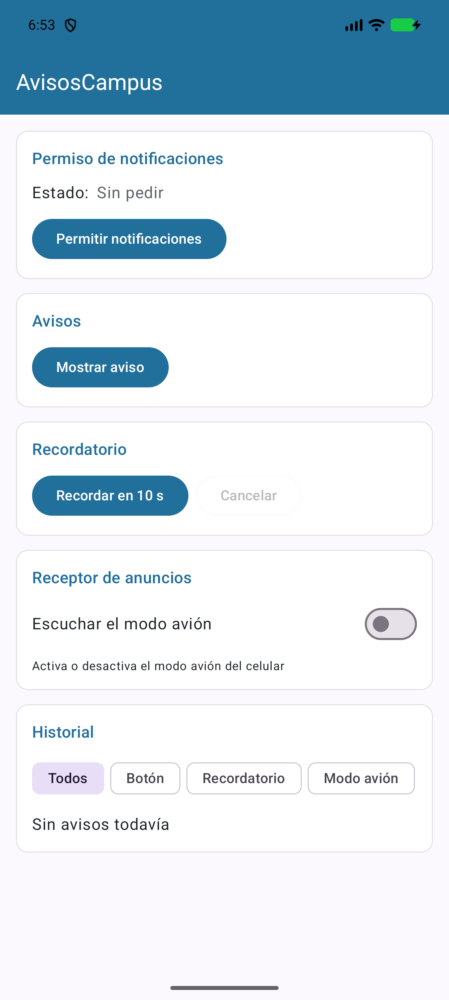

## Permiso de Android

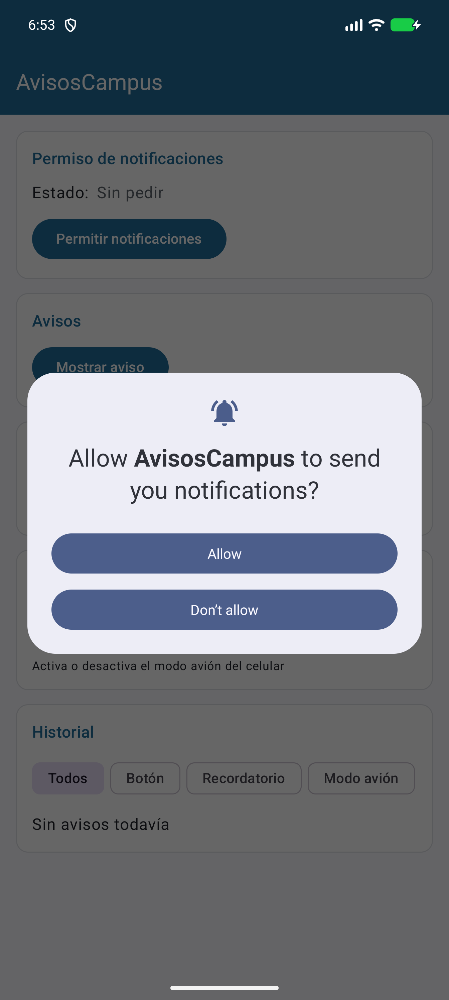

## Permiso denegado

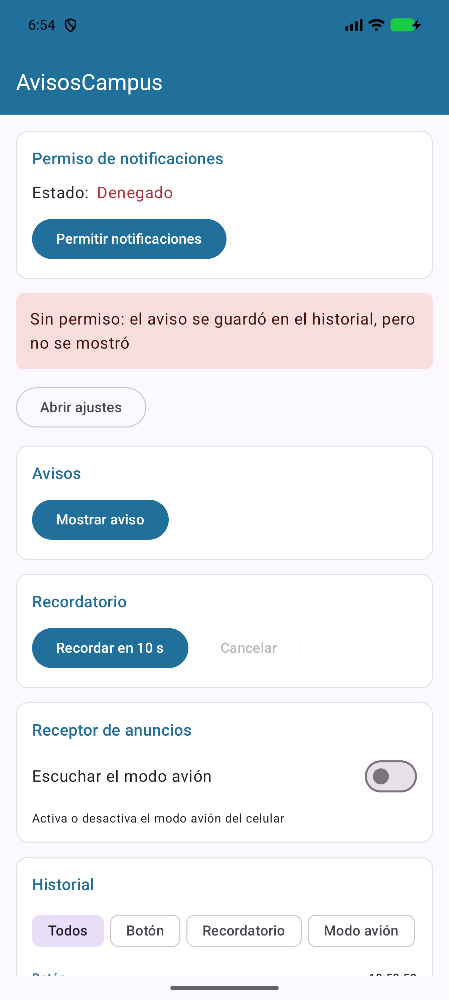

## Ajustes de notificaciones

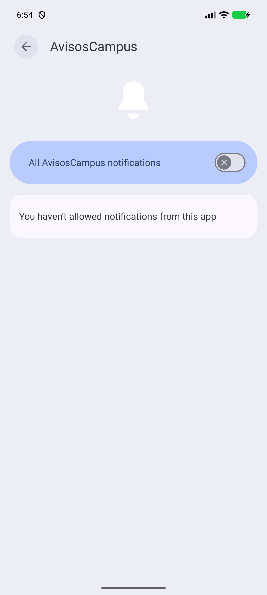

## Dos avisos en la bandeja

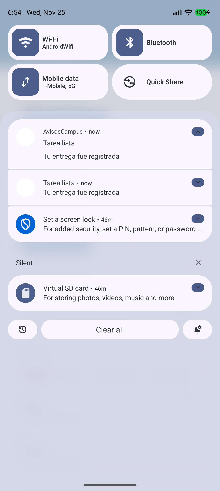

## Cuenta regresiva

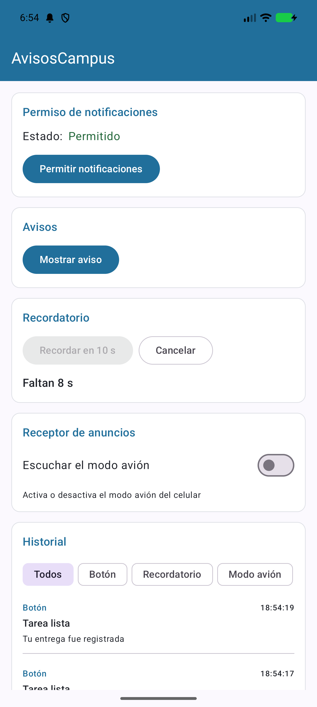

## Recordatorio al rotar

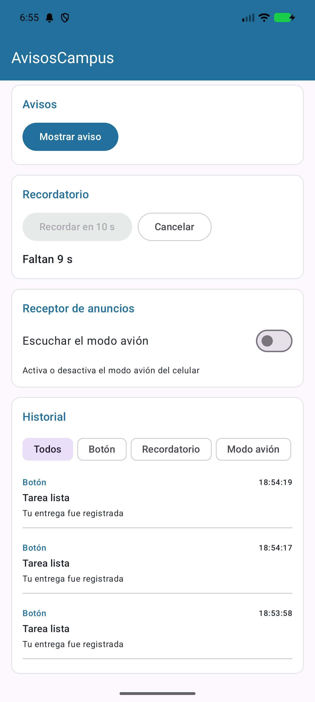

## Recordatorio recibido al minimizar

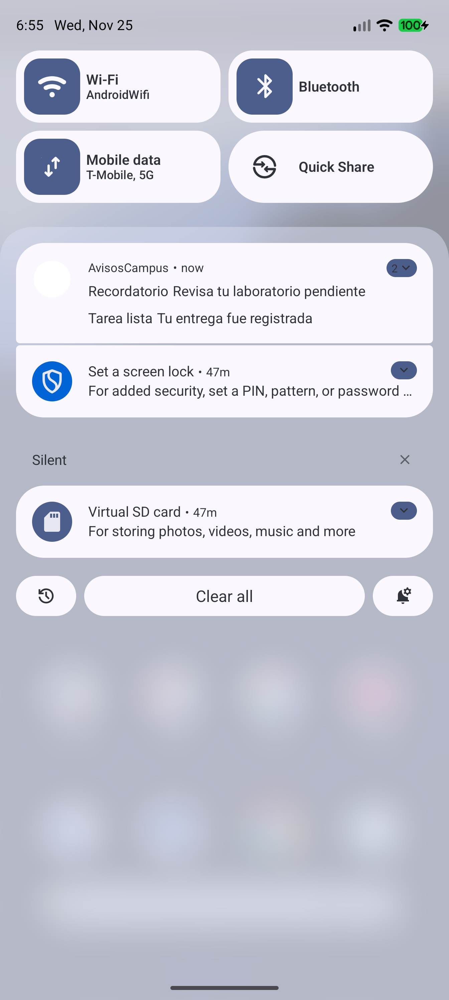

## Modo avión

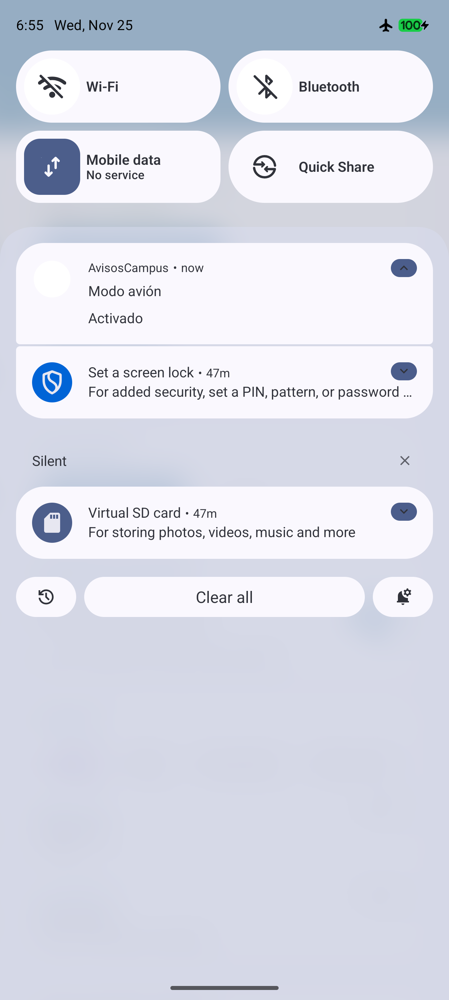

## Historial

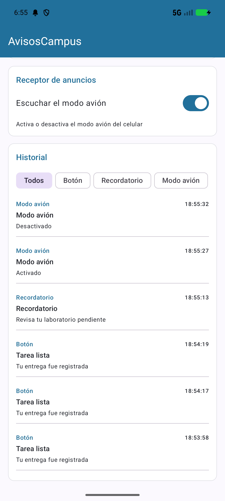

## Filtro propio por origen

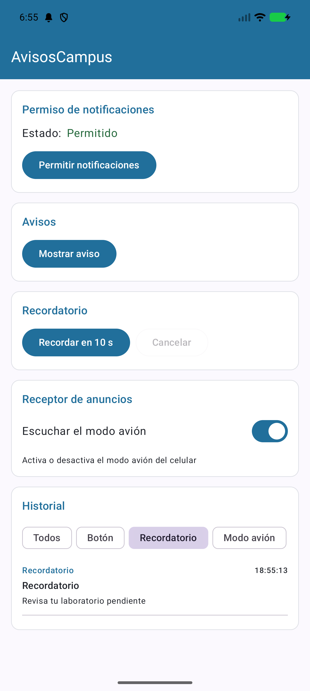

## Texto al 130 %

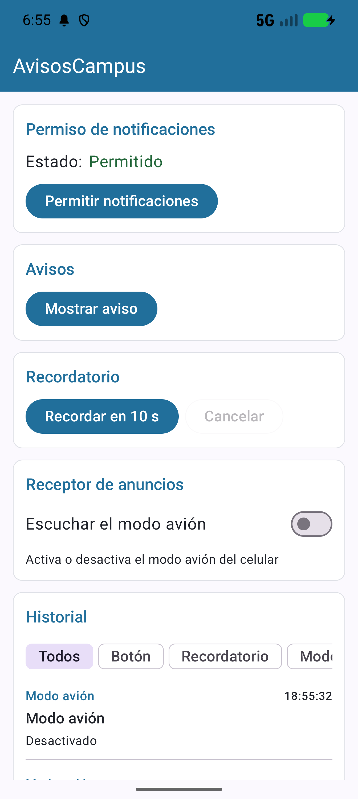

